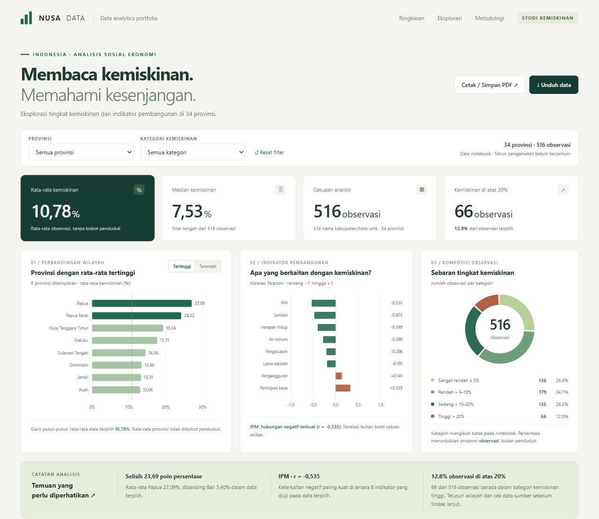

# Dashboard Analisis Kemiskinan Indonesia

Dashboard interaktif untuk mengeksplorasi perbedaan tingkat kemiskinan antarwilayah dan keterkaitannya dengan indikator pembangunan. Dibuat dari hasil analisis Python pada notebook `Kemiskinan (3).ipynb`.

## Fitur

- Filter provinsi dan kategori kemiskinan.
- Perbandingan rata-rata antarprovinsi.
- Korelasi Pearson untuk delapan indikator sosial ekonomi.
- Diagram sebar dengan pilihan indikator.
- Pencarian dan paginasi observasi kabupaten/kota.
- Ekspor CSV sesuai filter dan cetak melalui browser.

## Menjalankan

Buka `index.html` di browser. Seluruh data, CSS, dan JavaScript sudah tertanam; tidak memerlukan instalasi dependensi.

Untuk GitHub Pages, gunakan branch **main**, folder **/ (root)** pada pengaturan **Settings → Pages → Deploy from a branch**. Berkas `.nojekyll` disertakan untuk menyajikan halaman statis.

## Data dan interpretasi

516 observasi mencakup 514 kombinasi nama kabupaten/kota unik dan 34 provinsi. Rata-rata antarobservasi adalah 10,78%; median 7,53%. Angka rata-rata tidak dibobot penduduk dan bukan angka kemiskinan nasional resmi.

Tahun pengamatan dan sumber primer belum tercantum pada notebook. Dua wilayah memiliki dua baris berbeda. Nilai ekstrem dan pola desimal perlu diverifikasi pada sumber asli. Seluruh baris dipertahankan agar hasil sesuai notebook. Korelasi tidak membuktikan sebab-akibat.

Lihat [ringkasan analisis](ANALISIS.md) untuk temuan, proses pembersihan, serta batasan data.

## Teknologi

Analisis: Python, Pandas, NumPy, Matplotlib, Seaborn. Dashboard: HTML, CSS, JavaScript, dan SVG tanpa dependensi eksternal.
